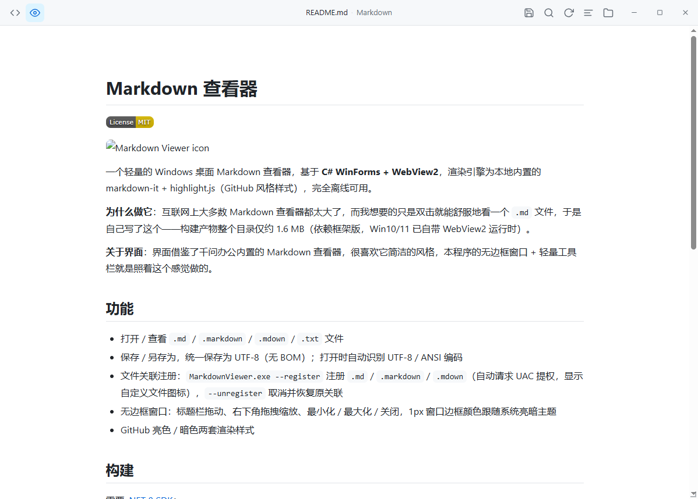

# Markdown 查看器

[](LICENSE)

<p></p>

一个轻量的 Windows 桌面 Markdown 查看器，基于 **C# WinForms（.NET Framework 4.8）+ WebView2**，渲染引擎为本地内置的 markdown-it + highlight.js（GitHub 风格样式），完全离线可用。

**为什么做它**：互联网上大多数 Markdown 查看器都太大了，而我想要的只是双击就能舒服地看一个 `.md` 文件，于是自己写了这个——构建产物整个目录仅约 1.2 MB，而且**目标机器零依赖**：.NET Framework 4.8 是 Windows 10 1903+ / Windows 11 系统自带组件，WebView2 运行时 Win10/11 也已内置，无需安装任何运行时。启动做了专门优化：双击后立即出现主题色加载画面，内容约半秒内无缝呈现，全程不露白板（本机实测，因机器而异）。

**关于界面**：界面借鉴了千问办公内置的 Markdown 查看器，很喜欢它简洁的风格，本程序的无边框窗口 + 轻量工具栏就是照着这个感觉做的。



## 功能

- 打开 / 查看 `.md` / `.markdown` / `.mdown` / `.txt` 文件
- 保存 / 另存为，统一保存为 UTF-8（无 BOM）；打开时自动识别 UTF-8 / ANSI 编码
- 文件关联注册：`MarkdownViewer.exe --register` 注册 `.md` / `.markdown` / `.mdown`（自动请求 UAC 提权，显示自定义文件图标），`--unregister` 取消并恢复原关联
- 无边框窗口：标题栏拖动、右下角拖拽缩放、最小化 / 最大化 / 关闭，1px 窗口边框颜色跟随系统亮暗主题
- GitHub 亮色 / 暗色两套渲染样式
- 启动优化：主题色加载占位（从不露白板）、WebView2 环境预热（浏览器进程拉起与窗口启动并行）

## 构建

编译只需要一个 .NET SDK（6.0+ 均可，推荐 8.0，仅编译机需要；已在 `.tools\dotnet` 放了本地 SDK 时直接可用）：

```bat
build.bat
```

产物输出在 `publish\` 目录，分发时拷贝整个 `publish` 文件夹即可，目标机器无需安装任何运行时。

桥接层的 JSON 编解码有一套回归测试，用 Windows 自带的编译器即可运行，无需安装 SDK：

```bat
tests\run-tests.bat
```

> **性能排查提示**：如果某台机器上所有 .NET 桌面程序启动都偏慢，多半是该机的 .NET Framework 原生映像（NGen）缓存缺失（即 `C:\Windows\assembly\NativeImages_v4.0.30319_64` 为空，正常情况下 Windows 安装时会自动生成）。以管理员身份运行一次即可修复：
>
> ```bat
> C:\Windows\Microsoft.NET\Framework64\v4.0.30319\ngen.exe install "System.Windows.Forms, Version=4.0.0.0, Culture=neutral, PublicKeyToken=b77a5c561934e089"
> ```
>
> **启动时间线**：设置环境变量 `MDV_TIMING=1` 后启动程序，各里程碑耗时（毫秒）会写入 `%TEMP%\mdv-timing.log`，可用来定位慢在哪一步（窗口显示 / 浏览器进程 / 导航 / 内容就绪）。

## 技术栈

| 组件 | 说明 |
|------|------|
| .NET Framework 4.8 WinForms | 窗口、文件对话框、注册表文件关联（Win10/11 系统自带，零安装） |
| WebView2 | 渲染界面（`file://` 直连本地 `wwwroot`，不经过虚拟主机/网络栈） |
| [markdown-it](https://github.com/markdown-it/markdown-it) 13.0.1 | Markdown 渲染（内置 `wwwroot/`，离线，MIT） |
| [highlight.js](https://github.com/highlightjs/highlight.js) 11.9.0 | 代码高亮 + GitHub 亮暗主题样式（内置，离线，BSD-3-Clause） |
| C# ↔ JS 桥接 | `WebMessageReceived` / `ExecuteScriptAsync`，负责打开、保存、窗口控制；JSON 编解码用自写的 [JsonLite](JsonLite.cs)（零依赖，配套 `tests/` 回归测试） |

## 第三方声明

本程序内置打包了 [markdown-it](https://github.com/markdown-it/markdown-it)（MIT）与 [highlight.js](https://github.com/highlightjs/highlight.js)（BSD-3-Clause），许可证全文见 [THIRD-PARTY-NOTICES.md](THIRD-PARTY-NOTICES.md)。

## 许可证

本项目以 [MIT](LICENSE) 许可证发布。
